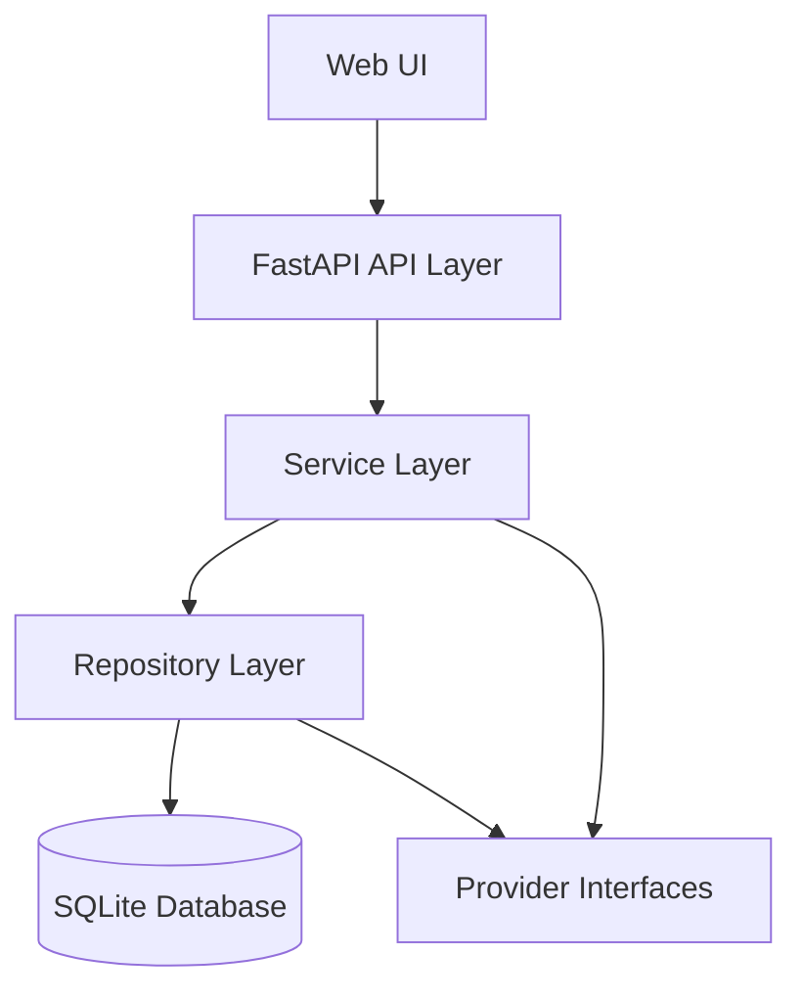

# System Architecture

## Overview

The Financial Ledger and Digital Wallet API follows a layered
architecture using FastAPI, Python and SQLite. The system provides
authenticated wallet management, idempotent transfers, an immutable
ledger and reconciliation.

## Layered Architecture

## Layer Responsibilities

| Layer | Responsibility |
|---|---|
| UI | Registration, login, wallets, transfers, history and admin operations |
| API | Request validation, authentication and HTTP responses |
| Service | Business rules, transaction processing and authorization |
| Repository | Parameterized SQL queries and data persistence |
| SQLite | Storage, constraints, transactions and immutability triggers |

## Service Components

- Auth and Session Service: User registration, login, session validation,
  expiration and logout.
- Wallet Service: Wallet creation, retrieval and balance management.
- Transfer Service: Validation and execution of wallet transfers.
- Ledger Service: Double-entry posting, reversals and hash chain management.
- Idempotency Service: Prevention of duplicate financial operations.
- Reconciliation Service: Verification of ledger and wallet consistency.

## Provider Interfaces

The database, clock, UUID generator and secure token generator are
accessed through provider interfaces. This allows production
implementations to be replaced with deterministic test fakes.

See [Provider Interfaces](design/provider-interfaces.md).

## Transaction Management

Financial writes execute inside a single SQLite transaction using
BEGIN IMMEDIATE. Ledger entries, wallet balances and idempotency
records are committed together. Any failure rolls back the operation.

SQLite uses WAL mode, foreign key enforcement, a five-second busy
timeout and FULL synchronous mode.

## Authentication and Authorization

Passwords are hashed using Argon2id. Successful login issues an
opaque bearer token with a 30-minute expiration period.

Only the SHA-256 digest of the token is stored in the database.
Protected endpoints validate the session and enforce role and
ownership restrictions before performing operations.

## Related Requirements

C-1, C-2, C-3, C-4, C-5, C-6, C-7,
FR-1, FR-2, FR-3, FR-4, FR-5, FR-6, FR-7.

## References

- [Database Schema](schema.sql)
- [ER Diagram](design/er-diagram.md)
- [Hash Chain Design](design/hash-chain.md)
- [[rest-api-design]]
- [[sqlite-acid-wal]]