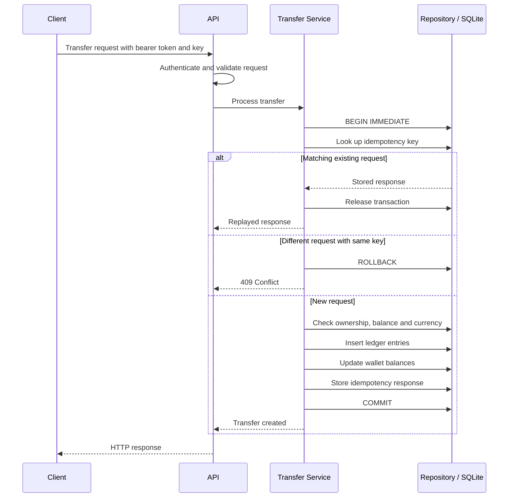

# Transfer Sequence Diagram

Any failed business check or database operation rolls back all
pending financial writes. A database lock timeout returns 503 DB_BUSY.

Related requirements: FR-2, FR-3, FR-4, FR-6.

Reference: SRS Appendix B.4.