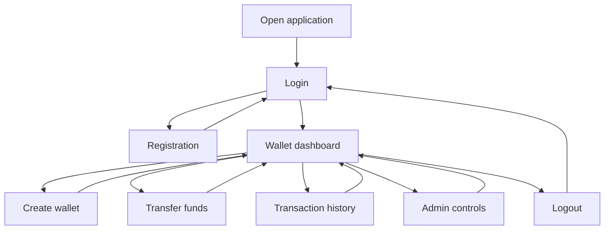

# Web UI Design

## 1. Overview

The Financial Ledger and Digital Wallet API provides a basic browser
interface for users and administrators.

The interface uses HTML, CSS and JavaScript and is served by the
FastAPI application at /app. It communicates with the backend through
the REST API.

The design covers all user interface requirements in FR-7.

## 2. Technology Stack

- HTML for page structure.
- CSS for styling and responsive layouts.
- JavaScript for API requests and interface interactions.
- FastAPI for serving the static application.
- Same-origin REST communication with the backend.

No external authentication or payment provider is required.

## 3. User Roles

| Role | Available operations |
|---|---|
| Visitor | Register and log in |
| USER | Create wallets, view balances, transfer funds, view history and log out |
| ADMIN | USER operations, wallet funding, transaction reversals and reconciliation |

The interface displays controls appropriate to the authenticated
role. Authorization is always enforced by the backend.

## 4. Navigation Flow

## 5. Screen Designs

### 5.1 Registration

Fields:

- Full name.
- Email address.
- Password.

Actions:

- Register.
- Return to login.

API: POST /auth/register

A successful registration directs the user to login.
All public registrations create USER accounts.

### 5.2 Login

Fields:

- Email address.
- Password.

Actions:

- Log in.
- Navigate to registration.

API: POST /auth/login

On success, the application stores the returned bearer token
in JavaScript memory and opens the wallet dashboard.

Invalid credentials display a generic authentication error.

### 5.3 Wallet Dashboard

Displays:

- Authenticated user name and role.
- Owned wallets.
- Wallet currency and available balance.
- Create wallet button.
- Transfer and history controls.
- Logout button.

APIs:

- GET /auth/me
- GET /users/me/wallets

The dashboard displays only the wallet list returned by the API.
It does not rely on a client-supplied owner identity.

### 5.4 Create Wallet

The user selects INR or USD and confirms wallet creation.

API: POST /users/{user_id}/wallets

A newly created wallet begins with a zero balance.

The dashboard refreshes after successful creation.
An existing wallet in the selected currency displays an appropriate
error message.

### 5.5 Transfer Funds

Fields:

- Sender wallet selected from the caller's owned wallets.
- Recipient wallet UUID.
- Transfer amount.
- Optional description.

API: POST /transfers

The amount is entered as decimal text and converted into integer
minor units before submission.

The submit button is disabled while the request is in progress.

After success, the interface displays a transaction receipt and
refreshes the wallet list.

### 5.6 Transaction History

Displays:

- Selected wallet.
- Ledger entry date and identifier.
- Debit or credit direction.
- Amount and currency.
- Transaction identifier.
- Pagination controls.

APIs:

- GET /ledger-entries?wallet_id=...
- GET /transactions/{transaction_id}

A normal USER must select an owned wallet when viewing ledger entries.

Selecting a transaction opens its details, including the ledger
entries and reversal information when available.

### 5.7 Administrator Panel

Administrative controls are displayed only for ADMIN accounts.

Available operations:

- Fund a wallet.
- Reverse an existing transaction.
- Run ledger reconciliation.

APIs:

- POST /wallets/{wallet_id}/fund
- POST /transactions/{transaction_id}/reverse
- GET /admin/reconciliation

The reconciliation view displays:

- Overall PASS or FAIL status.
- Checked transaction, wallet and entry counts.
- Identifiers associated with detected inconsistencies.
- Report generation time.

Administrative permissions are verified by the server for every
request.

## 6. Session Management

The login response provides an opaque bearer token with a
30-minute lifetime.

The browser:

- Stores the token only in JavaScript memory.
- Includes the token in the Authorization header of protected requests.
- Does not store the token in localStorage, sessionStorage or cookies.
- Clears session state after logout.
- Clears session state and returns to login after any HTTP 401 response.
- Requires login again after the browser page is reloaded.

Logout calls POST /auth/logout to revoke the server-side session.

If logout cannot reach the server, clear the local session and
inform the user that server-side revocation could not be confirmed.

See ADR-010 for the detailed design decision.

## 7. Monetary Input and Display

The backend uses integer minor units for all financial amounts.

Examples:

| Display amount | API amount_minor |
|---|---|
| INR 100.50 | 10050 |
| USD 25.00 | 2500 |
| INR 0.01 | 1 |

The interface converts decimal strings using exact integer logic,
without floating-point monetary arithmetic.

Input validation rejects:

- More than two decimal places.
- Zero or negative transfer amounts.
- Unsupported formats.
- Amounts above the permitted transaction limit.

The backend independently validates all submitted amounts.

## 8. Idempotent Requests

Funding, transfer and reversal operations require an
Idempotency-Key header.

The interface generates a new key for each intentional financial
operation.

If the result of a request is uncertain, the interface retains
the original key and identical payload in memory for retry.

The same key is reused until the result is known.
An intentional new operation receives a new key.

A replayed response is shown as the result of the existing
transaction, not as a new transaction.

The application does not automatically retry uncertain financial
operations after a page reload.

## 9. Error Handling

| HTTP status | UI behavior |
|---|---|
| 400 | Display validation feedback and allow correction |
| 401 | Clear session state and return to login |
| 403 | Display permission denied |
| 404 | Display resource not found |
| 409 | Display the relevant conflict message |
| 422 | Display the financial business-rule error |
| 503 | Display database busy and allow safe retry |
| 500 | Display a generic unexpected error |

The interface processes the shared code and message error format.

User-provided text is rendered as text rather than executable HTML.
No passwords, tokens, hashes, SQL statements or stack traces
are displayed in errors.

## 10. Accessibility and Responsive Design

- Label all form fields.
- Support keyboard navigation.
- Display loading and empty states.
- Provide clear error feedback.
- Disable active financial submission buttons.
- Support browser widths down to 360 pixels.
- Use readable text sizes and adequate color contrast.

## 11. Requirement Mapping

| Requirement | UI component |
|---|---|
| FR-7.1 | Registration and login |
| FR-7.2 | Wallet dashboard and creation |
| FR-7.3 | Transfer form and receipt |
| FR-7.4 | Idempotent retry behavior |
| FR-7.5 | Transaction history |
| FR-7.6 | Administrator panel |
| FR-7.7 | Logout and expired-session handling |
| NFR-8 | Prevention of duplicate submissions |
| NFR-14 | In-memory token and safe text rendering |
| NFR-21 | UI lint checks |
| NFR-22 | Cross-platform browser support |
| TQ-5 | Exact monetary input conversion tests |

## 12. Implementation Plan

Phase 4:

- Registration and login views.
- Wallet dashboard.
- Wallet creation.
- Session handling and logout.
- Static client linting and CI integration.

Phase 5:

- Transfer form and receipt.
- Transaction history.
- Administrator controls.
- Responsive layout and accessibility.
- JavaScript monetary conversion tests.

The Phase 4 static browser interface implements registration,
login, wallet creation, the wallet dashboard and logout.

Frontend JavaScript linting is integrated with CI.

Transfer forms, history views, administrator controls and
complete browser workflow tests remain Phase 5 deliverables.

## References

- [Software Requirements Specification](SRS.pdf)
- [System Architecture](architecture.md)
- [OpenAPI Specification](openapi.yaml)
- [ADR-010](adr/ADR-010-ui-session-design.md)
- [[authentication-sessions]]
- [[testing-strategy]]